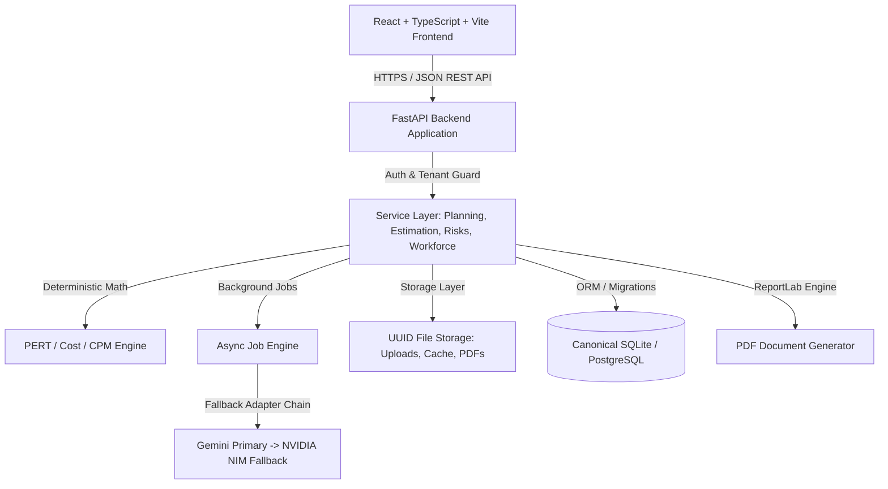

# DevMatrix AI — Architecture Specification

## 1. System Overview

DevMatrix AI is structured as a decoupled multi-tier web application designed for high security, tenant isolation, and verifiable business logic.

---

## 2. Component Design

### 2.1 Backend Layer (`backend/app`)
- **`core/`**: Canonical settings, database engine, security/JWT utilities, tenant context middleware.
- **`models/`**: SQLAlchemy 2.0 declarative models with `tenant_id` foreign keys and index strategies.
- **`schemas/`**: Strict Pydantic v2 schemas for request validation, structured AI parsing, and response serialization.
- **`api/`**: RESTful API endpoints grouped by domain (`auth`, `projects`, `documents`, `requirements`, `wbs`, `estimation`, `risks`, `workforce`, `execution`, `analytics`, `reports`, `admin`).
- **`services/`**:
  - `ai/`: Multi-provider abstraction (`BaseAIAdapter`, `GeminiAdapter`, `NvidiaNimAdapter`, `AIFallbackRouter`) with retry/backoff, JSON schema enforcement, and sanitization.
  - `jobs/`: Observable job execution engine (`JobManager`) tracking state transitions (`queued`, `running`, `succeeded`, `failed`, `cancelled`).
  - `documents/`: Magic byte validation, streaming extraction, section chunking.
  - `estimation/`: PERT calculator `(O + 4M + P)/6`, CPM schedule generator, rate-card cost aggregator.
  - `risks/`: Risk score calculation `L x I` and feasibility evaluator.
  - `workforce/`: Multi-criteria candidate ranking algorithm.
  - `reports/`: ReportLab PDF compiler.
- **`cli/`**: Seed scripts and management utilities.

### 2.2 Canonical Database & File Storage
- **Single Canonical Database Path**: Derived from project root: `<PROJECT_ROOT>/data/devmatrix.db` or configured via `DEVMATRIX_DATA_DIR`. Eliminates ambiguous relative `./devmatrix.db` paths.
- **Test Isolation**: All pytest test suites utilize temporary SQLite files (`tmp_path` fixture) or in-memory databases, never mutating developer databases.
- **File Storage**: Stored under `<PROJECT_ROOT>/storage/` with segregated subdirectories: `uploads/`, `extracted/`, `requirements/`, `reports/`. Stored with UUID filenames.

### 2.3 Frontend Layer (`frontend/src`)
- **Modern Dark Tech Design System**: Custom Tailwind palette (`slate-950` background, `indigo-600` primary, `violet-500` secondary, `amber-500` warning, `emerald-500` success).
- **Navigation Shell**: Collapsible sidebar with active route highlighting, tenant/user badge, project switcher, and real-time backend health indicator.
- **Feature Modules**:
  - `Dashboard`: Executive KPI cards, recent project alerts, delivery pulse.
  - `Projects & Intake`: Project creation, multi-file drag-and-drop intake, file preview modal.
  - `Requirements Review`: Dual-pane document reader and candidate requirement reviewer with conflict resolution and baseline approval.
  - `WBS & Planning`: Interactive task breakdown, dependency DAG view, cycle detection warnings.
  - `Estimation`: PERT three-point effort cards, role-rate cost breakdown, critical path timeline.
  - `Risks & Feasibility`: 7-dimension feasibility radar/bars, 5x5 risk heat matrix, mitigations register.
  - `Workforce`: Talent directory, skill-matrix matching, explainable candidate ranking, allocation approval.
  - `Execution`: Task kanban / status updates, milestone progress, blocker flagging.
  - `Analytics & Calibration`: Planned vs. actual trends, estimation accuracy calibration.
  - `Reports`: PDF preview & downloadable executive project summaries.
  - `Administration`: User role management, tenant settings, audit log explorer.

---

## 3. Security & Governance

1. **Role-Based Access Control (RBAC)**:
   - `tenant_admin`: Global tenant config, users, role assignment, audit logs.
   - `delivery_manager`: Project creation, baseline approvals, team assignments, report approvals.
   - `project_lead`: WBS task management, blockers, milestones, task progress.
   - `contributor`: Assigned tasks, status updates, work log correction requests.
2. **Untrusted AI Content Isolation**: Prompts contain anti-injection boundaries preventing document contents from executing instructions against the AI extractor.
3. **Audit Trails**: All critical state changes (baseline approval, task status change, team assignment, rate change) record tenant, user ID, timestamp, and previous/new state in `audit_logs`.
